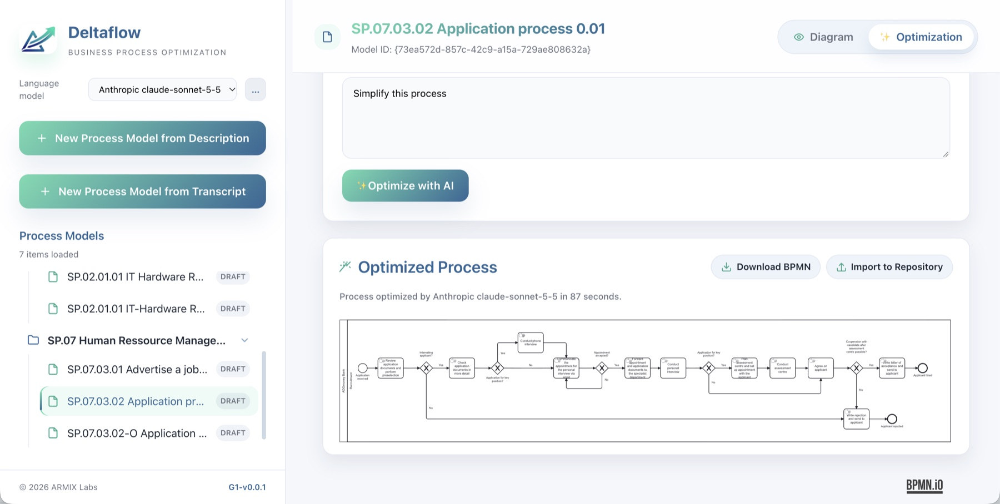
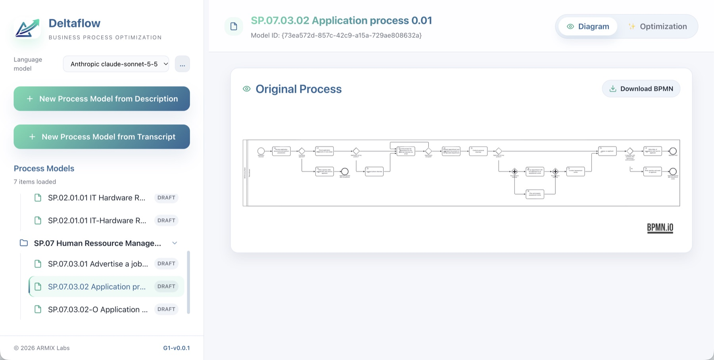
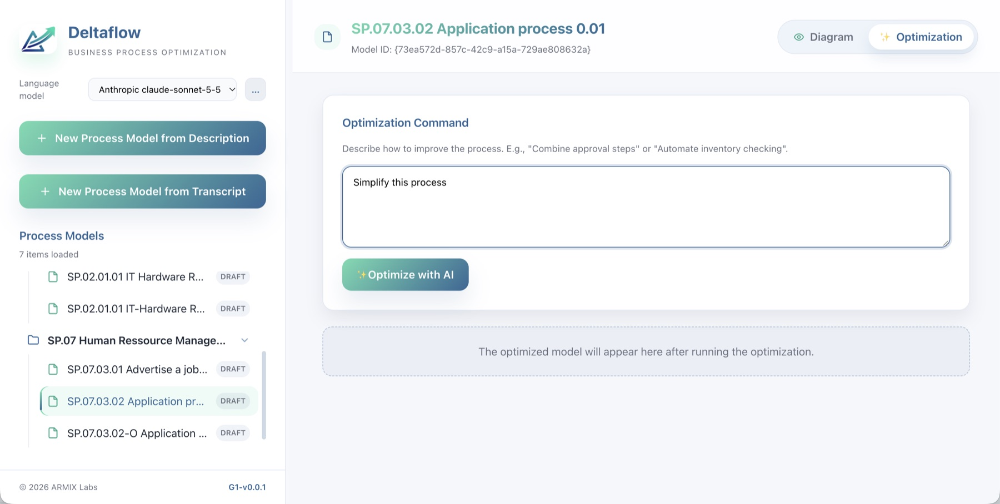
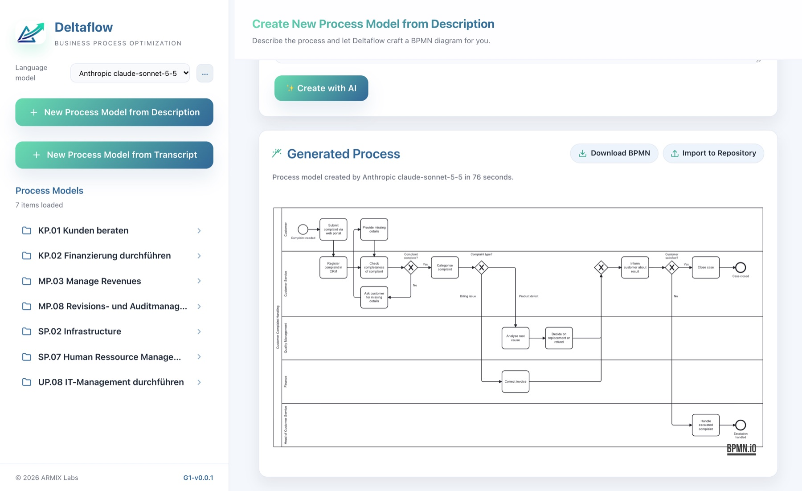
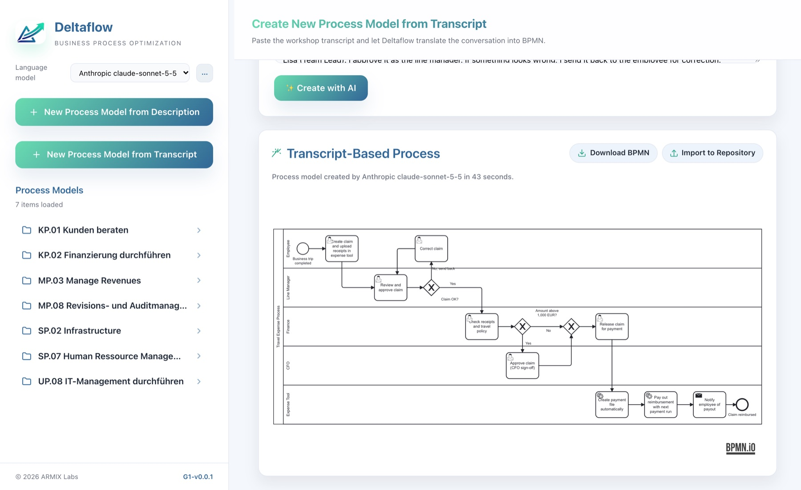
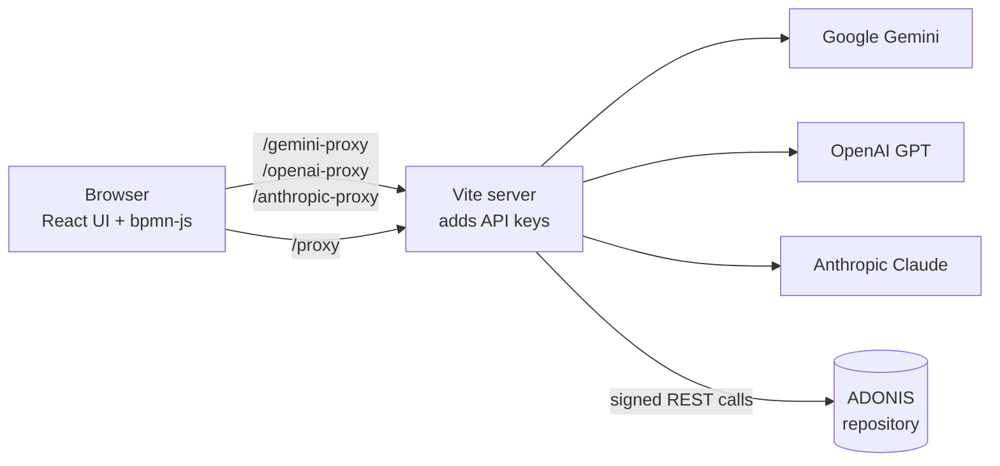

<p align="center">
  
</p>

<h1 align="center">Deltaflow</h1>

<p align="center">
  <strong>Turn process knowledge into BPMN 2.0 in minutes.</strong><br />
  An AI copilot that creates process models from text, voice or meeting transcripts<br />
  and optimises existing models from your BPM repository with a single prompt.
</p>

<p align="center">
  <a href="https://www.deltaflow.cloud"></a>
  
  
  
  <a href="LICENSE.md"></a>
</p>

<p align="center">
  
</p>

---

## Why Deltaflow?

Modelling business processes in BPMN 2.0 takes time and expertise. Deltaflow lets domain experts describe
a process in their own words – typed, spoken or discussed in a workshop – and turns it into a standard
BPMN 2.0 model. Existing models can be opened from an [ADONIS](https://www.boc-group.com/)
repository and improved with a simple instruction such as *“Parallelise the checks”*.

The AI drafts, the experts decide: every result can be reviewed, downloaded as `.bpmn` or imported back into
the repository as a new model – existing models are never overwritten.

Deltaflow was developed as the practical part of a master’s thesis (MSc) on generative AI in business
process management. It is a **private, non-commercial project**.

## Features

| | |
| --- | --- |
| 📝 **Create from a description** | Describe a process in plain language and get pools, lanes, tasks, gateways and events. |
| 🎙️ **Dictate instead of typing** | Speak your description in English or German; spoken punctuation is recognised. |
| 💬 **Turn workshops into models** | Upload a meeting transcript (TXT, CSV or WebVTT, e.g. from Microsoft Teams). |
| ✨ **Optimise with a prompt** | Apply changes like “add an approval lane” or “simplify this process” to an existing model. |
| 🗂️ **Connected to ADONIS** | Browse model groups via the ADONIS REST API and import results as new drafts. |
| 🧠 **Your choice of model** | Switch between Google Gemini, OpenAI GPT and Anthropic Claude per task. |
| 🔐 **Credentials stay on the server** | API keys and repository credentials never reach the browser. |
| 📦 **Open standard** | BPMN 2.0 XML that works with ADONIS, Camunda Modeler and other BPMN tools. |

## Screenshots

<table>
  <tr>
    <td width="50%">
      
      <p align="center"><strong>Browse the repository</strong><br />Open any BPMN model and view it in the browser.</p>
    </td>
    <td width="50%">
      
      <p align="center"><strong>Optimise with a prompt</strong><br />Describe the improvement and choose a language model.</p>
    </td>
  </tr>
  <tr>
    <td width="50%">
      
      <p align="center"><strong>Create from a description</strong><br />A few sentences become a model with lanes and decisions.</p>
    </td>
    <td width="50%">
      
      <p align="center"><strong>Create from a transcript</strong><br />Speakers and departments become swimlanes.</p>
    </td>
  </tr>
</table>

## How it works



1. **Provide the input** – a description, your voice, a workshop transcript or an existing model.
2. **AI drafts the model** – the selected language model returns BPMN 2.0 XML.
3. **Review and refine** – the diagram is rendered immediately; ask for further changes if needed.
4. **Export or import** – download the `.bpmn` file or import it into the repository as a new model.

## Getting started

**Prerequisites:** Node.js 22 or later, API keys for the language models you want to use and – optionally –
access to an ADONIS REST API.

```bash
npm install
```

Create a file `configparam.txt` with one `NAME=value` line per variable (see [Configuration](#configuration)).
Place it in the project root or one directory above it – it is ignored by Git. Then start the app:

```bash
bash setenv.sh npm run dev
```

The app runs at http://localhost:5173. Alternatively run `source ./setenv.sh` once and then `npm run dev`.

## Configuration

All connection settings are read from environment variables when the server starts (`npm run dev` or
`npm run preview`); nothing is stored in the code. Credentials stay on the server: its proxy routes add them to
the outgoing requests, so they are not part of the client bundle.

| Variable | Purpose |
| --- | --- |
| `ADO_REST_HOST` | ADONIS host name, without protocol |
| `ADO_REST_IDENTIFIER`, `ADO_REST_SECRET` | ADONIS REST API credentials (used to sign requests) |
| `ADO_REST_REPO` | ADONIS repository ID |
| `ADO_REST_ROOTMODELGROUP` | Model group shown as root folder and used as import target |
| `GEMINI_API_BASE`, `GEMINI_API_KEY`, `GEMINI_MODEL` | Google Gemini API endpoint, key and model ID |
| `OPENAI_API_BASE`, `OPENAI_API_KEY`, `OPENAI_MODEL` | OpenAI API endpoint, key and model ID |
| `ANTHROPIC_API_BASE`, `ANTHROPIC_API_KEY`, `ANTHROPIC_MODEL`, `ANTHROPIC_HAIKU_MODEL`, `ANTHROPIC_VERSION` | Anthropic API endpoint, key, model IDs (main and Haiku entry) and API version |

Optional: `ADONIS_USE_PROXY`, `ADONIS_PROXY_PATH`, `ADONIS_API_BASE`, `GEMINI_TIMEOUT_MS`.

Example `configparam.txt` (replace the placeholders):

```ini
ADO_REST_HOST=your-adonis-host.example.com
ADO_REST_IDENTIFIER=your-identifier
ADO_REST_SECRET=your-secret
ADO_REST_REPO=00000000-0000-0000-0000-000000000000
ADO_REST_ROOTMODELGROUP=00000000-0000-0000-0000-000000000000
GEMINI_API_BASE=https://generativelanguage.googleapis.com
GEMINI_API_KEY=your-gemini-key
GEMINI_MODEL=gemini-3.8-flash
OPENAI_API_BASE=https://api.openai.com/v1
OPENAI_API_KEY=your-openai-key
OPENAI_MODEL=gpt-6.1-sol
ANTHROPIC_API_BASE=https://api.anthropic.com
ANTHROPIC_API_KEY=your-anthropic-key
ANTHROPIC_MODEL=claude-sonnet-5-5
ANTHROPIC_HAIKU_MODEL=claude-haiku-5-5
ANTHROPIC_VERSION=2023-06-01
```

## Project structure

| Path | Purpose |
| --- | --- |
| `src/App.tsx` | Application shell: repository browsing, creation and optimisation views |
| `src/components/` | Sidebar, BPMN viewer, configuration dialog, icons |
| `src/hooks/` | Repository loading, AI calls, speech-to-text, status messages |
| `src/services/` | Gemini, OpenAI and Anthropic clients; ADONIS read and import |
| `src/utils/` | XML helpers, transcript parser, configuration access |
| `server/` | Server-side signing of ADONIS REST requests |
| `vite.config.ts` | Dev/preview server with the proxy routes that add credentials |
| `setenv.sh` | Loads `configparam.txt` into environment variables |

## License

Copyright 2025–2026 DI Armin Baldemair, MSc MBA.

Deltaflow is free to use for noncommercial purposes and for internal use within any organisation,
under your choice of the [PolyForm Noncommercial License 1.0.0](LICENSES/PolyForm-Noncommercial-1.0.0.md)
or the [PolyForm Internal Use License 1.0.0](LICENSES/PolyForm-Internal-Use-1.0.0.md). Selling it,
building it into products or offering it as a service requires a commercial license – contact
info@armixlabs.com. See [LICENSE.md](LICENSE.md) for details.

Deltaflow is provided as is, without warranty and without any obligation to provide support,
maintenance or bug fixes. AI-generated process models may contain errors and must be reviewed
before use.

ADONIS is a trademark of the BOC Group. Gemini, GPT and Claude are trademarks of their respective owners.
